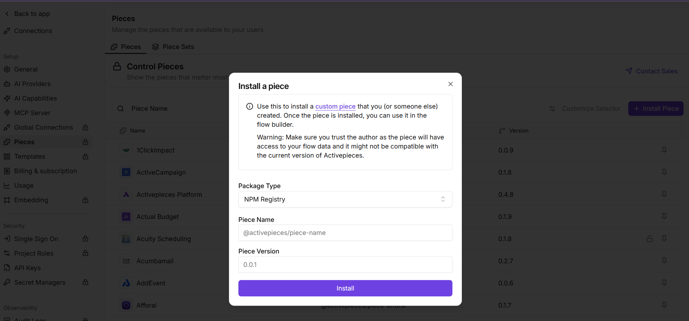

# GPT Image for Activepieces

通过 Ace Data Cloud 创建 GPT Image 任务，并按**同一个任务 ID**查询结果。Piece 提供 **Create GPT Image task** 和 **Get GPT Image task** 两个动作。提交返回 ID 并不代表图片已完成；查询到 `succeeded` 后才可使用成品。[English](README.md)

**分发方式：**在 Activepieces 实例中将 `@acedatacloud/piece-gpt-image@0.1.3` 作为自定义 Piece 安装。公开 npm 包不会自动进入 Activepieces 共享目录。

## 安装与连接

Activepieces 0.92.2+ 中进入 **Platform Admin → Catalogue → Pieces → Install Piece → NPM Registry**，填写 `@acedatacloud/piece-gpt-image` 和版本 `0.1.6`。在流程中搜索 **GPT Image**，核对 Ace Data Cloud Logo 和两个动作。

1. 在 [Ace Data Cloud Applications](https://platform.acedata.cloud/console/applications?utm_source=opensource&utm_medium=referral&utm_campaign=evergreen) 注册或登录。页面会自动准备好**通用应用**卡片。
2. 可使用**通用应用**或具备 **GPT Image** 权限的应用。通用 Key 可访问账号已获授权的服务；专用 Key 仅限对应服务。
3. 点击应用卡片上 **API KEY** 旁的复制按钮，或通过 **Manage Keys → Create** 创建名为 `Activepieces GPT Image` 的独立 Key，按需设置有效期与用量限制。若启用 **Allowed APIs**，应同时包含 `/openai/images/generations` 与 `/openai/tasks`，创建后复制 Key。
4. 创建 Activepieces 连接，只填写 API Key 本身，不加 `Bearer `。`platform-...` 管理 Token 不是生成 API Key。Key 留在连接中，不写入流程导出。生成前查看当前[价格](https://platform.acedata.cloud/models?utm_source=opensource&utm_medium=referral&utm_campaign=evergreen)。应用余额不足时，点击该应用卡片上的**充值**。

## 首次流程

1. 添加 **Create GPT Image task**。**Model** 与 **Quality** 下拉框读取当前公开图片生成接口目录，选择精确型号及其支持的参数，目录包含兼容别名。模型、尺寸和数量默认值仍为 `gpt-image-2`、`1024x1024` 和 `1`。质量为可选项且不预填；留空时请求不发送 quality 字段，由 API 使用所选模型的默认值。
2. **只运行一次**创建动作，保存输出的 `task_id`。动作使用 `callback_url` 异步提交，不设置 HTTP 重试。若超时或返回 5xx，先查[请求历史](https://platform.acedata.cloud/console/usages?utm_source=opensource&utm_medium=referral&utm_campaign=evergreen)再考虑重提，任务可能已被接收。
3. 添加 **Get GPT Image task**，把 **Task ID** 映射为创建动作的输出。只查询同一个 ID，直至 `status=succeeded` 或 `failed`。pending 时不会把预览当作最终媒体。
4. 仅当 `success=true` 时打开 `media_urls`。若原始请求自带自定义 Trace ID 且丢失任务 ID，也可按 Trace ID 查询；本 Piece 的创建动作不设置自定义 Trace ID。

[无密钥首跑流程](https://raw.githubusercontent.com/AceDataCloud/GPTImageActivepieces/main/examples/gpt-image-quickstart.json) 导入后两个连接均为空，任务 ID 映射保留。运行前请配置自己的连接；创建动作已关闭自动重试。

本次校验的目录包含 24 个型号和 8 个质量选项；下拉框刷新时读取当前目录。DALL-E 2 的质量选项仅含 `standard`；DALL-E 3 仅含 `standard` 或 `hd`，图片数量固定为 `1`。明确填写了不支持的 DALL-E 质量时，会在提交前报错。其它型号的参数限制以当前接口说明为准。图片数量为 1–10，每张成功图片可能单独计费；`size` 支持 `auto` 或 `WIDTHxHEIGHT`。查询任务不会再次生成或计费。

目录读取不携带连接、提示词或 API Key。元数据不可用时，下拉框明确显示错误，不返回缩水的备用列表；刷新字段可重试。已有保存流程继续使用其保存的模型 ID 和明确指定的质量，执行时无需查询目录；不合法的 DALL-E 质量需改为支持值或清空。首跑模板不预填质量，避免切换型号时带入 GPT 专用的质量值。本 Piece 实现图片生成与任务查询，尚未提供图片编辑动作。

此前隔离的 Activepieces CE 0.92.2 验证已接受构建归档，并通过 **Get GPT Image task** 查询一条既有完成任务；流程返回 `succeeded` 和 1 个最终图片 URL。本轮未通过创建动作提交新的付费图片任务。

## 排障

| 现象 | 处理 |
| --- | --- |
| 401 / 403 | 核对 Key、GPT Image 权限和两个路径的 Allowed APIs。 |
| 400 | 核对提示词、模型、`WIDTHxHEIGHT` 尺寸和图片数量。 |
| `pending` | 等待并查询同一任务 ID，不重跑创建。 |
| 429 | 降低并发，避免自动重试付费创建。 |
| 创建超时或 5xx | 先检查请求历史，再考虑再次提交。 |
| `failed` 或任务不存在 | 检查任务或 Trace ID 及保留期限。 |

Piece 只向 `https://api.acedata.cloud` 发送所选输入和 API Key，仅在终态返回媒体 URL，并过滤内部路由字段。[源码](https://github.com/AceDataCloud/GPTImageActivepieces) · [支持](https://github.com/AceDataCloud/GPTImageActivepieces/issues) · dev@acedata.cloud。

生成及任务请求验证 HTTPS 证书，且仅访问 `api.acedata.cloud`。公开目录从固定的 `platform.acedata.cloud` 接口 schema 地址读取，不携带认证信息，验证 HTTPS 证书且不跟随重定向。网络失败与 HTTP 错误不自动重试；重新创建前先查请求历史。Piece 不提供独立代理设置。

## 图文配置参考

2026-10-18 复用的真实/官方参考图，[固定来源与边界](docs/screenshots/onboarding-source.json)保留。安装图不是本 Piece 已被官方共享目录收录的证明。管理员安装后按服务名搜索并核对 **GPT Image** 和已安装的 `@acedatacloud/piece-gpt-image` 包；Key 只放动作连接。源码 PR、npm 发版、官方目录收录与真实首用分别验收。
